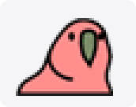
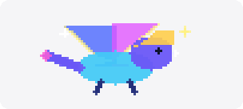

# NetBar

[](https://github.com/sunnyhot/NetBar/releases/latest)


NetBar 是一个免费的 macOS 菜单栏网络流量监控 App。它把实时下载、上传速度放进菜单栏，点击后可以查看网络趋势、今日统计和应用级流量，持续高流量时还会本地提醒。菜单栏里还可以养一只动态小宠物，网络越忙跑得越快。

它适合想长期观察网络状态、排查网速异常、了解哪些应用正在使用网络的人。NetBar 使用 macOS 系统接口和系统自带工具读取统计数据，不抓包，不读取网页、请求、聊天、文件等网络内容，也不需要管理员权限。

## 为什么用 NetBar

- **一眼看见实时网速**：菜单栏直接显示当前下载 / 上传速度，不需要打开活动监视器。
- **知道谁在用网**：详情窗口展示应用级实时流量，支持搜索和系统进程过滤。
- **发现异常更快**：总流量持续超过自定义阈值时可发送本地提醒。
- **趋势不只看瞬间**：内置最近趋势图和今日流量统计，适合判断网络是不是持续异常。
- **菜单栏养只小宠物**：35 个内置动态角色，动画速度跟随网络活动，也可以导入自己的角色。
- **菜单栏可自定义**：多种显示模式、布局、颜色模式（纯色 / 彩虹 / 霓虹 / 火焰 / 极光）、字号、顺序、宽度和对齐方式。
- **轻量、透明、免费**：纯 Swift 实现，无外部依赖，不抓包，不需要管理员权限。
- **适合长期挂着**：低流量、低电量、锁屏等场景会自动降低采样或暂停部分刷新，减少不必要的资源消耗。

## 主要功能

### 菜单栏实时监控

NetBar 会在菜单栏显示当前网络速度，默认展示下载和上传速率。你可以在偏好设置里切换上下行、仅下载、仅上传或总速率模式。

菜单栏支持的自定义项包括：

- 下载 / 上传 / 总流量显示模式
- 单行或双行布局
- 自动宽度或手动宽度
- 字号、文字颜色
- 颜色模式：纯色、彩虹、霓虹、火焰、极光
- 下载 / 上传顺序和对齐方式

### 菜单栏动态小宠物

NetBar 内置 35 个动态角色，会常驻菜单栏陪你上网。角色动画是逐帧绘制的，不占用额外窗口，也不会干扰菜单栏布局。按分类全部展示如下（GIF 为固定帧率演示，实际动画速度跟随网络活动变化）：

**默认 · 7 个**

<table>
<tr>
<td align="center"><br><sub>猫咪 α</sub></td>
<td align="center"><br><sub>猫咪 β</sub></td>
<td align="center"><br><sub>猫咪 γ</sub></td>
<td align="center"><br><sub>猫尾巴</sub></td>
<td align="center"><br><sub>彩虹猫</sub></td>
<td align="center"><br><sub>游戏猫</sub></td>
</tr>
<tr>
<td align="center"><br><sub>派对鹦鹉</sub></td>
</tr>
</table>

**生物 · 10 个**

<table>
<tr>
<td align="center"><br><sub>猎豹</sub></td>
<td align="center"><br><sub>小狗</sub></td>
<td align="center"><br><sub>幼犬</sub></td>
<td align="center"><br><sub>兔子</sub></td>
<td align="center"><br><sub>青蛙</sub></td>
<td align="center"><br><sub>棱镜狐</sub></td>
</tr>
<tr>
<td align="center"><br><sub>星辉幼龙</sub></td>
<td align="center"><br><sub>柴犬</sub></td>
<td align="center"><br><sub>兔兔</sub></td>
<td align="center"><br><sub>企鹅</sub></td>
</tr>
</table>

**非生物 · 8 个**

<table>
<tr>
<td align="center"><br><sub>齿轮</sub></td>
<td align="center"><br><sub>篝火</sub></td>
<td align="center"><br><sub>水滴</sub></td>
<td align="center"><br><sub>火箭</sub></td>
<td align="center"><br><sub>钟摆</sub></td>
<td align="center"><br><sub>咖啡杯</sub></td>
</tr>
<tr>
<td align="center"><br><sub>小云朵</sub></td>
<td align="center"><br><sub>小盆栽</sub></td>
</tr>
</table>

**季节 · 4 个**

<table>
<tr>
<td align="center"><br><sub>驯鹿与雪橇</sub></td>
<td align="center"><br><sub>雪人</sub></td>
<td align="center"><br><sub>风铃</sub></td>
<td align="center"><br><sub>线香烟花</sub></td>
</tr>
</table>

**特别 · 6 个**

<table>
<tr>
<td align="center"><br><sub>黄金猫</sub></td>
<td align="center"><br><sub>金属集群猫</sub></td>
<td align="center"><br><sub>闪光猫</sub></td>
</tr>
<tr>
<td align="center"><br><sub>招财猫</sub></td>
<td align="center"><br><sub>幻彩史莱姆</sub></td>
<td align="center"><br><sub>寿司</sub></td>
</tr>
</table>

角色系统的玩法包括：

- **动画速度跟随网络活动**：网络空闲时角色慢慢踱步（约 0.5 帧/秒），流量升高后加速奔跑（最高 10 帧/秒），网速就是角色的心跳。
- **可选的动画速度来源**：除了网速，也可以让角色跟随 CPU 使用率、内存占用、热状态或自动综合指标，把小宠物变成一块负载仪表。
- **深浅色自适应**：单色角色会自动适配浅色 / 深色菜单栏；彩色角色保留原色，大部分角色还支持自定义色调。
- **角色轮换**：开启后按设定间隔从你选定的角色池中随机切换，保持新鲜感。
- **省电设计**：网络空闲超过 30 秒角色会定格休息，锁屏时动画自动暂停。
- **最爱英雄**：详情窗口会统计每个角色的累计播放次数，告诉你最喜欢哪只小宠物。
- **自定义角色**：支持导入静态图片、GIF 动图或多张帧图（PNG / JPG / GIF / WebP / TIFF / BMP），几步就能把自己的表情包放进菜单栏。

### 详情窗口

点击菜单栏项目后，NetBar 会打开详情窗口，集中展示当前网络状态：

- 当前总速率、上下行速度与主网络接口名称
- 最近趋势脉冲图，可切换时间窗口
- 今日流量统计与「最爱英雄」卡片
- 应用级实时流量列表与应用归因说明

### 应用级流量

NetBar 通过 macOS 自带的 `/usr/bin/nettop` 获取应用级网络统计。

应用列表支持：

- 按实时流量排序
- 应用搜索
- 系统进程隐藏
- 代理、VPN、子进程和系统服务标记

需要注意的是，应用级流量和接口总流量不一定完全一致。代理、VPN、浏览器 Helper、系统网络扩展或子进程可能会承接真实流量，NetBar 会尽量给出归因提示，帮助你理解差异。

### 高流量提醒

NetBar 可以在本地检测持续高流量，并通过 macOS 通知提醒你：

- 当前总流量过高

首次使用时可以选择是否开启系统通知，也可以在偏好设置中调整阈值或关闭检测。

### 历史统计

NetBar 会基于本地采样维护轻量历史数据，用于趋势判断：

- 最近趋势窗口
- 今日流量统计

这些数据用于观察趋势，不等同于运营商账单或系统网络用量报表。

### 外观与体验

NetBar 支持：

- 中文和英文界面
- 跟随系统、浅色、深色外观
- 显示 Dock 图标或仅保留菜单栏
- 开机启动
- 自动更新检查
- 内置 RunCat 动画角色
- 自定义角色图片处理和存储

## 隐私与权限

NetBar 的设计目标是只读取必要的系统统计数据。

- 不抓包
- 不读取网络请求内容
- 不读取网页内容
- 不读取聊天内容
- 不需要管理员权限
- 不需要安装内核扩展或系统扩展
- 不上传你的网络数据

NetBar 使用的数据来源主要是：

- `getifaddrs`：读取 macOS 网络接口累计计数器，用于计算实时接口速率。
- `/usr/bin/nettop`：读取 macOS 自带的应用级网络统计。
- Mach / SystemConfiguration：读取主网络接口信息；系统资源（CPU / 内存 / 热状态）仅在动画速度来源启用时采样，用于驱动角色动画速度。

## 下载安装

推荐 Homebrew（自动跟随最新 Release，且不受 Gatekeeper 未公证拦截，无「已损坏」提示）：

```bash
brew tap sunnyhot/tap
brew install --cask sunnyhot/tap/netbar
```

或从 GitHub Releases 手动下载：

[下载 NetBar 最新版本](https://github.com/sunnyhot/NetBar/releases/latest)

1. 下载 `NetBar.app.zip`。
2. 解压得到 `NetBar.app`。
3. 将 `NetBar.app` 拖入 `/Applications`。
4. 双击打开，或右键选择「打开」（未公证首次打开可能提示「已损坏」，解决方法见下节）。

## macOS 提示“已损坏”的解决方法

如果从 GitHub Release 下载后，macOS 提示「NetBar 已损坏，无法打开」，通常是因为 App 未经过 Apple 公证，Gatekeeper 阻止了首次启动。

可以在终端执行：

```bash
xattr -cr /Applications/NetBar.app
```

如果你把 App 放在其他位置，请把路径替换为实际的 `NetBar.app` 路径。

也可以尝试右键点击 App，选择「打开」，然后在弹窗中再次点击「打开」。

## 系统要求

- macOS 13.0 或更高版本
- Apple Silicon 或 Intel Mac
- 构建源码需要 Xcode 15 或更高版本，以及 Swift 6.0 工具链

源码以 Swift 5 模式编译，项目使用 Swift Package Manager 管理。

## 从源码构建

克隆仓库后，在项目根目录执行：

```bash
./Scripts/build-app.sh
```

构建产物会生成在：

```text
build/NetBar.app
```

运行构建后的 App：

```bash
open build/NetBar.app
```

开发时也可以直接运行可执行目标：

```bash
swift run NetBar
```

运行测试：

```bash
swift test
```

## 打包 Release（本地验证）

执行：

```bash
./Scripts/package-release.sh
```

产物会生成在：

```text
dist/NetBar.app.zip
dist/NetBar.app.zip.sha256
```

## 发布流程

正式发布由 GitHub Actions 自动完成，配置在 `.github/workflows/release.yml`。推送 `v*` tag 后，Actions 会根据 tag 写入 App 版本号、打包 `NetBar.app.zip`，并创建 GitHub Release。

NetBar 的自动更新优先读取 Release 资产 `latest.json`，失败后回退 GitHub Releases API。Release 里必须包含固定资产名 `NetBar.app.zip`，这个名字来自 `Resources/Info.plist` 的 `NBUpdateAssetName`。

1. 确认要发布的代码已经提交，并同步到最新 `main`。

```bash
git status --short --branch
git pull --rebase origin main
swift test
./Scripts/package-release.sh
```

2. 选择新版本号并推送 tag。tag 必须以 `v` 开头；Actions 会把 `v0.32.4` 转成 App 版本号 `0.32.4`，写入 `CFBundleShortVersionString`，并用 Actions run number 写入 `CFBundleVersion`。

```bash
VERSION=0.32.4
TAG="v$VERSION"
git tag -a "$TAG" -m "$TAG"
git push origin main "$TAG"
```

3. 等待 GitHub Actions 完成 `Build & Release` workflow。

```bash
git ls-remote origin main "refs/tags/$TAG"
```

打开仓库的 Actions 页面查看构建状态。workflow 成功后应完成这些动作：

- 将 tag 版本写入 `Resources/Info.plist`
- 构建并验证 `dist/NetBar.app.zip`
- 上传 `NetBar.app.zip`、`NetBar.app.zip.sha256` 和 `latest.json`
- 创建 GitHub Release：`https://github.com/sunnyhot/NetBar/releases/tag/$TAG`

4. 验证 Release 和更新入口。

```bash
curl -I -L "https://github.com/sunnyhot/NetBar/releases/download/$TAG/NetBar.app.zip"
curl -Ls -o /dev/null -w '%{url_effective}\n' "https://github.com/sunnyhot/NetBar/releases/latest"
```

确认 zip 地址返回 `200` 并带有合理的 `content-length`，`releases/latest` 最终跳转到新 tag。如果当前 App 已经是同版本，检查更新会正常显示没有更新。

当前构建脚本会使用 ad-hoc codesign 进行本地签名。正式分发时建议使用开发者证书签名并进行 Apple notarization，以减少用户首次打开时的 Gatekeeper 提示。

## 技术实现

NetBar 是纯 Swift macOS App，无第三方依赖，主要使用 AppKit、SwiftUI、Combine、Foundation、SystemConfiguration 和 Mach API。

核心数据流如下：

```text
getifaddrs / nettop / Mach
  -> Reader 协议
  -> NetworkMonitor
  -> @Published 快照
  -> Combine 订阅
  -> StatusBarController
  -> NSStatusItem 图像
```

关键模块：

- `NetworkMonitor`：核心监控引擎，负责接口速率、应用流量采样、历史数据和高流量检测。
- `NetworkStatsReader`：读取网络接口计数器，并识别主网络接口。
- `ApplicationTrafficReader`：通过 `nettop` 读取应用级流量。
- `SystemResourceReader`：读取系统内存、CPU 和热状态，用于可选的角色动画速度来源。
- `StatusBarController`：管理 macOS 菜单栏项目、点击交互和渲染刷新。
- `StatusBarStyle`：状态栏偏好模型和持久化。
- `StatusBarColorStyle`：状态栏颜色模式、调色板和布局枚举。
- `StatusBarRenderer`：CoreGraphics 渲染引擎，负责菜单栏文字和角色绘制。
- `RunCatAnimation`：内置角色定义、帧动画推进、活动强度映射和角色轮换。
- `NetworkPopoverView`：SwiftUI 详情窗口内容（位于 `Popover/`）。
- `AppPreferences`：偏好设置和 UserDefaults 持久化。
- `AppUpdater` / `AppUpdateRelease`：基于 GitHub Releases 的自动更新协调、Release 解析和完整性校验。

## 项目结构

```text
NetBar
├── Sources/NetBar
│   ├── Main.swift
│   ├── AppDelegate.swift
│   ├── NetworkMonitor.swift
│   ├── StatusBarController.swift
│   ├── StatusBarStyle.swift
│   ├── StatusBarColorStyle.swift
│   ├── StatusBarRenderer.swift
│   ├── RunCatAnimation.swift
│   ├── CustomCharacter*.swift
│   ├── Popover/
│   ├── Preferences/
│   └── ...
├── Resources
│   ├── Info.plist
│   ├── NetBar.entitlements
│   └── RunCat/
├── Scripts
│   ├── build-app.sh
│   ├── package-release.sh
│   └── generate-icon.swift
├── Tests/NetBarTests
├── Package.swift
└── README.md
```

更详细的架构说明可以查看 `PROJECT_MAP.md`。

## 常见问题

### 为什么应用流量总和小于菜单栏总流量？

菜单栏总流量来自网络接口计数器，表示网卡层面的总收发速度。应用列表来自 `nettop` 的进程统计。代理、VPN、系统服务、浏览器 Helper、网络扩展和子进程都可能影响归因，所以两者不会总是完全相等。

### NetBar 会不会看到我访问了什么网站？

不会。NetBar 不抓包，也不读取请求内容。它只读取系统已经汇总好的字节数、包数、进程名等统计信息。

### 为什么历史统计只是估算？

历史统计基于 App 本地采样。如果 App 没有运行、系统休眠、锁屏暂停、采样间隔变化，都会影响统计精度。因此它适合判断趋势，不适合作为账单级精确数据。

### 为什么需要 `--disable-sandbox` 构建？

构建脚本需要组装 `.app`、复制资源并进行本地签名。运行时还需要访问系统工具，例如 `nettop`。因此本项目的构建脚本使用 `swift build --disable-sandbox -c release`。

### 为什么没有上架 Mac App Store？

NetBar 依赖 `nettop` 等系统工具读取本地统计数据，并包含自更新流程。目前更适合通过 GitHub Releases 分发。

## 反馈与贡献

欢迎通过 GitHub Issues 反馈问题、建议功能或描述你的使用场景：

[提交反馈](https://github.com/sunnyhot/NetBar/issues)

如果你想参与开发，可以先运行：

```bash
swift test
./Scripts/build-app.sh
```

提交修改时请尽量保持以下约定：

- UI 和用户可见文案同时考虑中文和英文。
- 新增偏好项需要持久化，并确认默认值合理。
- 修改状态栏渲染时重点检查 `StatusBarRenderer.swift` 和 `StatusBarColorStyle.swift`；偏好持久化检查 `StatusBarStyle.swift`。
- 修改网络读取逻辑时尽量保持协议可注入，方便测试。
- 修改发布流程时同步检查版本号、更新说明和打包产物。

## 许可与使用

NetBar 当前面向个人免费使用。如果你计划复制、修改或二次分发代码，请以仓库后续补充的 LICENSE 文件为准。
